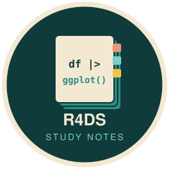

# R for Data Science: study notes 

**My notes and exercise solutions for *R for Data Science* (2nd edition) by Hadley Wickham, Mine Çetinkaya-Rundel and Garrett Grolemund**

These notes follow the 2nd edition of *R for Data Science*, the standard introduction to the tidyverse. They cover the book's first part, **"Whole game"**, which goes through the full data science workflow: visualizing, transforming and tidying data, and organizing code and projects. Each chapter has an R Markdown notebook (`.Rmd`) with my notes and exercise solutions, plus a rendered version (`.md`, readable directly on GitHub).

> **Book:** Wickham H., Çetinkaya-Rundel M. and Grolemund G. (2023). *R for Data Science*, 2nd edition. O'Reilly. Free online at [r4ds.hadley.nz](https://r4ds.hadley.nz/).

## 📚 Chapters

| Chapter | Topic | My notes |
|---|---|---|
| **Part 1: Whole game** | | |
| 2 | Data visualization | [notes](Ch2_Data_visualization.md) |
| 3 | Workflow: basics | [notes](Ch3_Workflow_basics.md) |
| 4 | Data transformation | [notes](Ch4_Data_transformation.md) |
| 5 | Workflow: code style | [notes](Ch5_Workflow_code_style.md) |
| 6 | Data tidying | [notes](Ch6_Data_tidying.md) |
| 7 | Workflow: scripts and projects | [notes](Ch7_Workflow_scripts_and_projects.md) |

## 🧠 Skills practiced

- **Visualization:** the grammar of graphics with `ggplot2` (`palmerpenguins` data, `ggthemes`), saving plots with `ggsave()`
- **Data transformation:** filtering, arranging, grouping and summarizing with `dplyr` (`nycflights13` data)
- **Tidy data:** pivoting longer and wider with `tidyr`, reading data with `readr`
- **Workflow:** code style, scripts, R projects and reproducible paths

## 📂 Using these notes

Open any chapter's `.md` file to read it on GitHub, or clone the repository and open the `.Rmd` files in RStudio to run the code (requires the `tidyverse`, `palmerpenguins`, `nycflights13` and `ggthemes` packages).

## License and credits

My notes and code are released under the MIT License. The figures in `diagrams/`, `images/` and `screenshots/` are reproduced unchanged from *R for Data Science* under [CC BY-NC-ND 3.0](https://creativecommons.org/licenses/by-nc-nd/3.0/us/); see [`NOTICE.md`](NOTICE.md).

## AI assistance

The README, repository clean-up and badge were prepared with the assistance of Claude Opus 5.5 (Anthropic), used through Claude Code. The study notes were written by Min-Yao Jhu. All changes were reviewed and approved by the author.

## Contact

**Min-Yao Jhu**, Senior Research Scientist, Donald Danforth Plant Science Center · [minyaojhu.com](https://www.minyaojhu.com) · [GitHub](https://github.com/MinYaoJhu)
